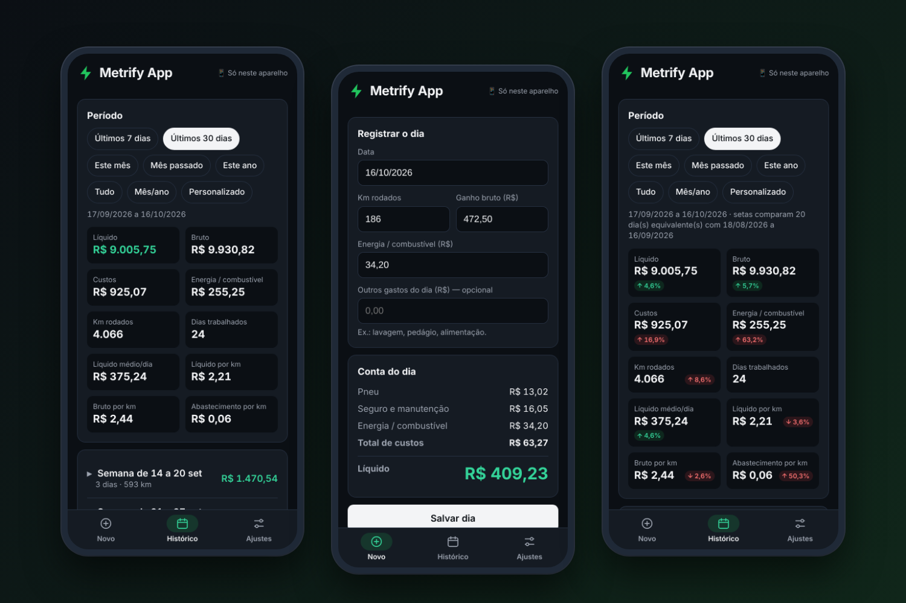
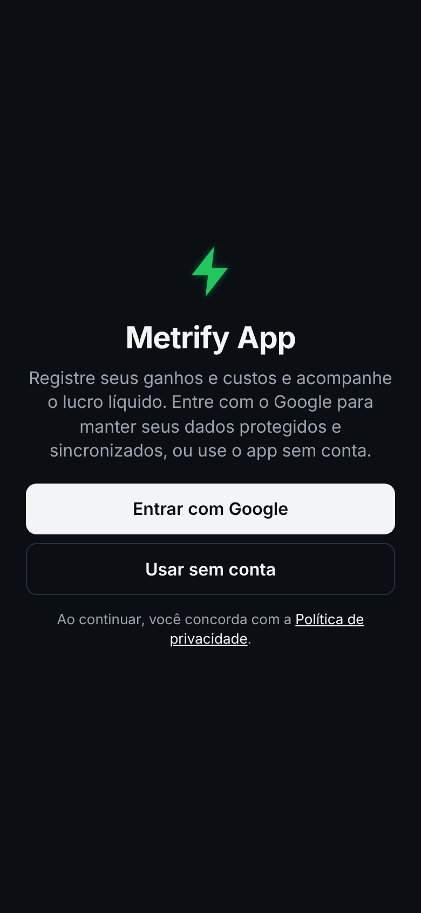
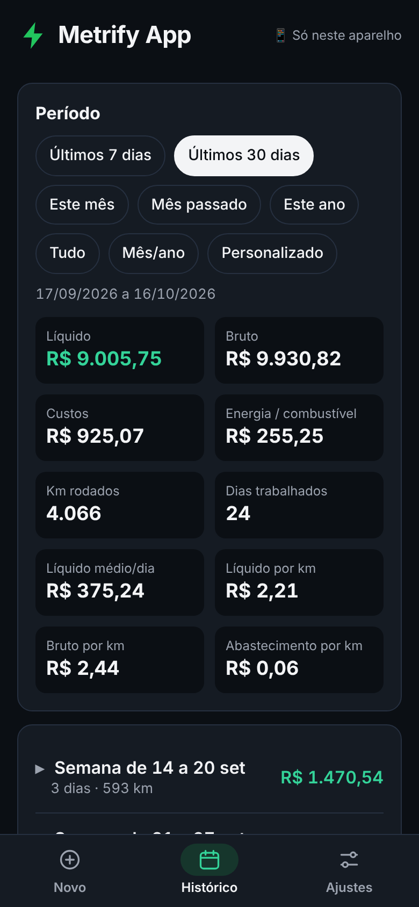
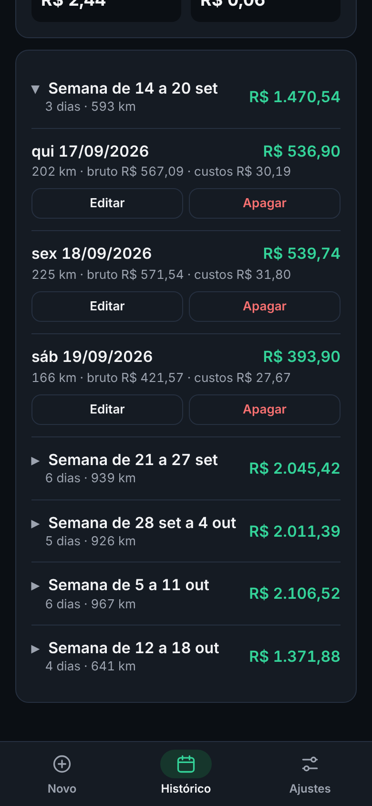
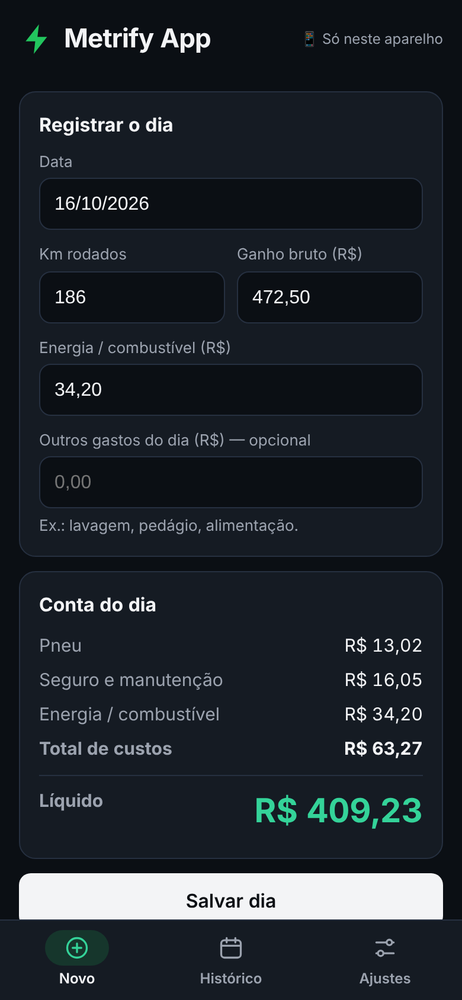
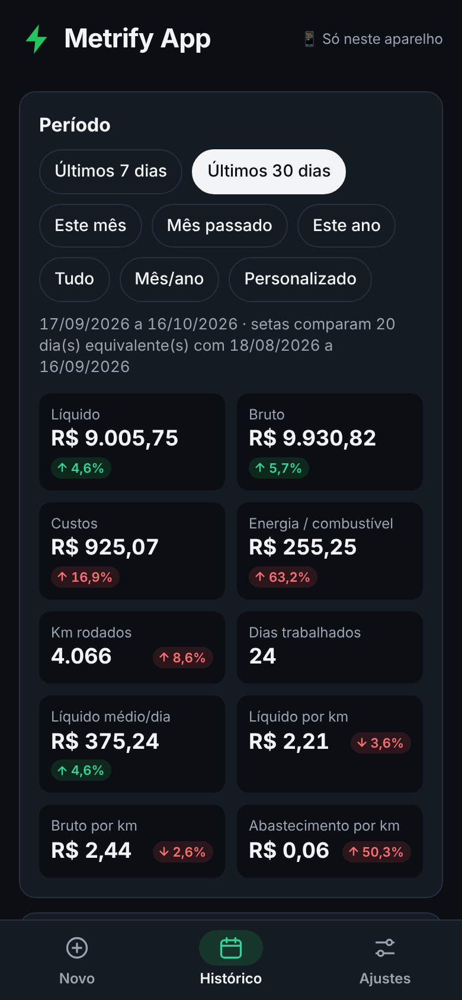
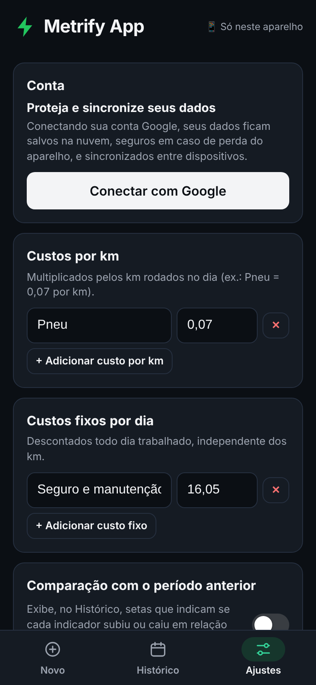
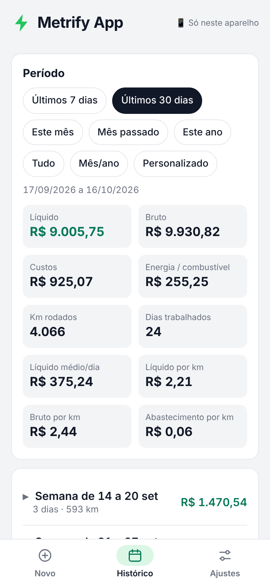

<div align="center">



# ⚡ Metrify App

**Controle de ganhos, custos e lucro para motoristas de aplicativo.**
Registre o dia em segundos e veja quanto realmente sobrou no bolso.

[](https://viniciusdelucena.github.io/metrify/)


</div>

---

## 📖 Sobre

O **Metrify App** nasceu de um caderninho de papel. Todo dia o motorista anotava os km rodados, o quanto ganhou e o quanto gastou, e só no fim descobria o lucro de verdade. O Metrify faz essa conta sozinho, em poucos toques, e mostra a evolução por semana, mês e ano.

Ele foi pensado para ser **simples, rápido e funcionar sem internet**, inclusive para quem usa carro elétrico (há um campo próprio para energia ou combustível).

> As capturas de tela deste README usam **dados fictícios**.

## ✨ Recursos

- **Registro do dia em segundos:** data, km rodados, ganho bruto, gasto com energia/combustível e outros gastos.
- **Conta automática do dia:** custos por km (ex.: pneu a R$ 0,07/km) e custos fixos diários (ex.: R$ 16,05) são descontados sozinhos, e o lucro líquido aparece na hora.
- **Histórico organizado por semanas**, em ordem cronológica e recolhidas por padrão, para o mês não virar uma lista enorme.
- **Filtros de período:** últimos 7 ou 30 dias, este mês, mês passado, este ano, tudo, mês/ano (só aparecem anos e meses que têm registros) e período personalizado.
- **Resumo completo do período:** líquido, bruto, custos, energia/combustível, km rodados, dias trabalhados, líquido médio por dia, líquido por km, bruto por km e abastecimento por km.
- **Comparação com o período anterior (opcional):** setas verdes e vermelhas mostram se cada indicador melhorou ou piorou. A comparação é justa: o dia 1 do período atual é comparado com o dia 1 do período anterior, e assim por diante, considerando só os dias que existem nos dois.
- **Os valores da época ficam congelados:** mudar um custo hoje não altera os dias já salvos.
- **Dois jeitos de usar:**
  - **Sem conta:** os dados ficam só no aparelho.
  - **Com conta Google:** backup na nuvem e sincronização entre celular e computador.
- **Backup e restauração** em JSON, e exportação em planilha (CSV).
- **Funciona offline** e pode ser instalado na tela inicial como um app.
- **Exclusão de conta e dados** dentro do próprio app, além de página pública com as instruções.
- **Tema claro e escuro** automáticos, de acordo com o aparelho.

## 📱 Capturas de tela

<table>
  <tr>
    <td align="center" width="25%"><br><sub><b>Tela inicial</b><br>Entrar com Google ou usar sem conta</sub></td>
    <td align="center" width="25%"><br><sub><b>Histórico</b><br>Filtros e resumo do período</sub></td>
    <td align="center" width="25%"><br><sub><b>Semanas</b><br>Dias agrupados e recolhidos</sub></td>
    <td align="center" width="25%"><br><sub><b>Registrar o dia</b><br>Conta calculada na hora</sub></td>
  </tr>
  <tr>
    <td align="center"><br><sub><b>Comparação</b><br>Setas verdes e vermelhas (opcional)</sub></td>
    <td align="center"><br><sub><b>Ajustes</b><br>Conta, custos e preferências</sub></td>
    <td align="center"><br><sub><b>Tema claro</b><br>Acompanha o aparelho</sub></td>
    <td></td>
  </tr>
</table>

## 🧮 Como o lucro é calculado

```
custos do dia = (km rodados × custos por km) + custos fixos do dia + energia/combustível + outros gastos
lucro líquido = ganho bruto − custos do dia
```

Os custos por km e os custos fixos são configurados em **Ajustes** e podem ser editados quando quiser. Cada dia guarda uma cópia dos valores da época em que foi registrado.

## 🔒 Privacidade e dados

- **Sem conta:** nada sai do aparelho. Os registros ficam no armazenamento do navegador ou do app.
- **Com conta Google:** os dados ficam no **Cloud Firestore**, em `usuarios/{uid}/...`, e cada pessoa só enxerga os próprios registros.
- Sem anúncios, sem rastreadores e sem Google Analytics.
- 📄 [Política de privacidade](https://viniciusdelucena.github.io/metrify/privacidade.html)
- 🗑️ [Como excluir sua conta e seus dados](https://viniciusdelucena.github.io/metrify/excluir-conta.html)

Exemplo de regras de segurança do Firestore (cada conta acessa apenas os próprios dados):

```
rules_version = '2';
service cloud.firestore {
  match /databases/{database}/documents {
    match /usuarios/{uid}/{documento=**} {
      allow read, write: if request.auth != null && request.auth.uid == uid;
    }
  }
}
```

## 🛠️ Tecnologia

| Camada | O que é usado |
|---|---|
| Interface | HTML, CSS e JavaScript puros, em **um único `index.html`** (sem framework e sem build) |
| App instalável | PWA: `manifest.webmanifest` + service worker (`sw.js`) |
| Offline | Service worker com rede primeiro para as páginas (assim uma nova versão chega só com um commit) e cache para ícones e para o SDK |
| Login | Firebase Authentication (somente Google) |
| Nuvem | Cloud Firestore com cache persistente local |
| Android | Trusted Web Activity gerada pelo [PWABuilder](https://www.pwabuilder.com/) |
| Hospedagem | GitHub Pages |

## 📂 Estrutura do repositório

```
metrify/
├── index.html              # o app inteiro
├── sw.js                   # service worker (offline e cache)
├── manifest.webmanifest    # dados de instalação do PWA
├── privacidade.html        # política de privacidade
├── excluir-conta.html      # instruções para excluir conta e dados
├── icon-192.png  icon-512.png  icon-maskable-512.png  apple-touch-icon.png
└── img/                    # capturas de tela usadas neste README
```

O arquivo `.well-known/assetlinks.json`, que liga o site ao app Android, fica no repositório do site de usuário (`viniciusdelucena.github.io`).

## 🚀 Rodando localmente

Não há dependências nem etapa de build. Basta servir a pasta com qualquer servidor estático:

```bash
git clone https://github.com/viniciusdelucena/metrify.git
cd metrify
python3 -m http.server 8080
# abra http://localhost:8080
```

No modo **sem conta** tudo funciona na hora. Para testar o login e a sincronização, é preciso apontar o `firebaseConfig` do `index.html` para um projeto Firebase seu, com Authentication (Google) e Firestore ativados, e adicionar o endereço usado em *Authentication → Configurações → Domínios autorizados*.

## 📦 Publicação

- **Web:** cada commit na branch publicada atualiza o site pelo GitHub Pages. O app avisa quando há uma versão nova.
- **Android:** o pacote é gerado no PWABuilder com o mesmo endereço do site. Como o app é um *wrapper* do site, as atualizações de conteúdo chegam sem publicar uma nova versão na loja. Só é preciso um novo pacote quando mudam nome, ícone ou configurações do aplicativo.
- **Google Play:** em preparação.

## 💡 Sugestões

Quer sugerir uma melhoria? Use **Ajustes → Sugira uma melhoria** dentro do app, ou abra uma *issue* aqui no repositório.

---

<div align="center">
Feito por <a href="https://github.com/viniciusdelucena">Vinícius</a>, motorista de aplicativo, para motoristas de aplicativo. ⚡
</div>
